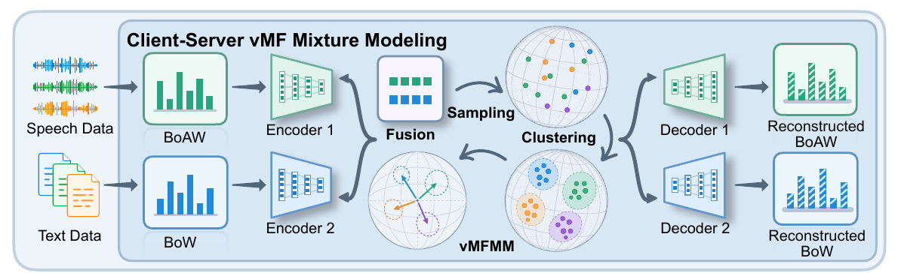
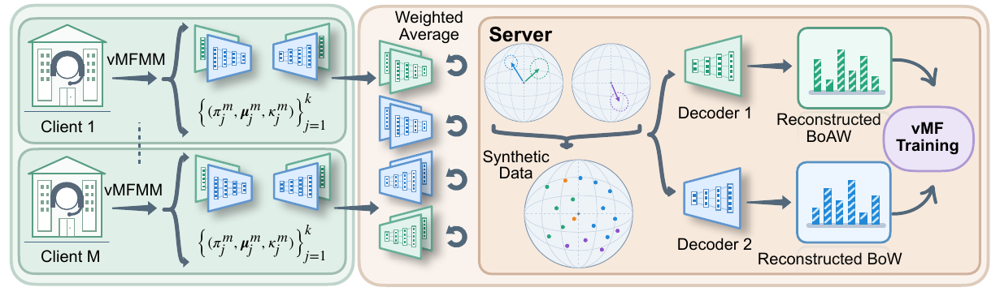
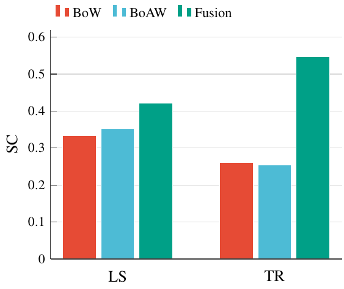
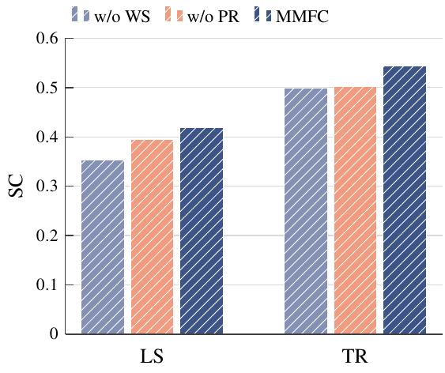
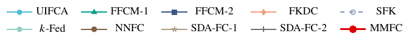
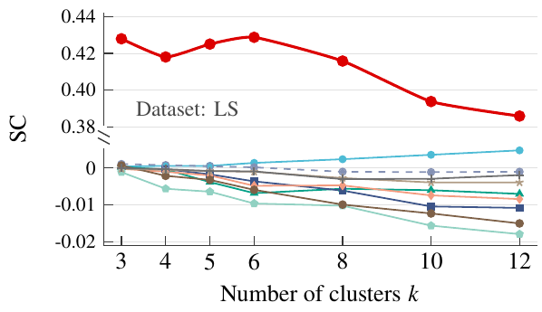
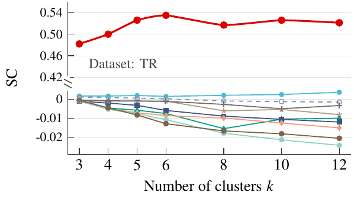

# Multimodal Federated Clustering for Speech-Text Data via Hyperspherical Mixture Modeling

## Intro

This repository accompanies our proposed MultiModal Federated Clustering (MMFC) framework for paired speech-text data. MMFC learns a unified global clustering structure from distributed unlabeled observations without sharing raw data.

**Authors:** Shenghong Cai, Dayu Guo, Zhixiang Li, Zhiwen Luo, Nizar Bouguila, and Wentao Fan.

The framework has three main components:

- **Hyperspherical multimodal representation learning:** modality-specific encoders process textual Bag-of-Words (BoW) and acoustic Bag-of-Acoustic-Words (BoAW) features, which are fused into a shared hyperspherical latent space with a sample-specific von Mises-Fisher (vMF) posterior.
- **Local directional clustering:** each client learns a client-specific von Mises-Fisher Mixture Model (vMFMM) to capture its local cluster structure.
- **Generative global aggregation:** the server aggregates encoder and decoder parameters by local sample counts, samples latent representations using client-component mixture weights, and uses the aggregated global decoders to generate pseudo multimodal observations for global representation and cluster learning.



*Figure 1(a): Common client/server architecture for multimodal representation learning, vMF mixture-based clustering, and modality-specific reconstruction.*



*Figure 1(b): Federated workflow with local learning, parameter aggregation, pseudo multimodal data generation, and global cluster-structure learning.*

> **Code release:** this repository currently provides a simplified public implementation. The framework figures and comparison results describe the complete MMFC method reported in the manuscript.

## Requirements

- Python >= 3.11
- torch >= 2.0
- numpy >= 1.24
- scipy >= 1.10
- scikit-learn >= 1.3
- nltk >= 3.9

Install the dependencies and NLTK resources from the repository root:

```shell
python -m pip install -r requirements.txt
python -m nltk.downloader -d .nltk_data punkt punkt_tab averaged_perceptron_tagger averaged_perceptron_tagger_eng stopwords wordnet omw-1.4
```

## How to run

```shell
python train.py --dataset xxx
```

**xxx: select the dataset you want to run: `libri1024`, `tedlium1024`, or `both`.**

The manuscript evaluates the following paired speech-text datasets:

| Dataset | Abbreviation | Argument | Paired samples | BoW dimension | BoAW dimension |
| :--- | :---: | :---: | ---: | ---: | ---: |
| LibriSpeech | LS | `libri1024` | 5,466 | 18,231 | 1,024 |
| TED-LIUM Release 3 | TR | `tedlium1024` | 2,351 | 9,295 | 1,024 |

These sample counts and feature dimensions are the manuscript's experimental settings. The public loader constructs its text vocabulary from the selected split. Processed datasets are included under `datasets/1024-LibriSpeech` and `datasets/1024-TEDLIUM_release3`; raw audio is not included.

The public training defaults are 5 clients, 6 clusters, a 20-dimensional latent space, 20 deterministic pretraining rounds, and 50 federated rounds. The encoder hidden layers are `[1024, 512, 256]`, and the decoders use the mirrored configuration `[256, 512, 1024]`.

The default device is `cuda:0` when CUDA is available, otherwise `cpu`. Use `--device cpu` to select the CPU. View all available parameters with:

```shell
python train.py --help
```

Use `--data_root` to select another dataset root and `--rebuild_data_cache` to rebuild cached features. The selected split must contain at least `num_clients * n_clusters` samples.

## Example

Train on LibriSpeech:

```shell
python train.py --dataset libri1024
```

Train on TED-LIUM Release 3:

```shell
python train.py --dataset tedlium1024
```

Train on both datasets sequentially:

```shell
python train.py --dataset both
```

Running `python train.py` also trains on both datasets by default. Each run saves `training.log`, `metrics.csv`, `server_model.pt`, `global_vmfmm.pt`, and `predictions.npy` under `outputs/<dataset>/`. Predictions follow the selected CSV split's row order, and checkpoints record `implementation: simplified`.

## Comparison Results

The manuscript compares MMFC with UIFCA, FFCM-1, FFCM-2, FKDC, SFK, $k$-Fed, NNFC, SDA-FC-1, and SDA-FC-2 over ten independent runs. The default paper setup uses five clients with $k$-means-based non-IID partitioning, $k=6$, a latent dimension of 20, a clustering-loss weight of 0.001 on both clients and the server, and 1,024 pseudo samples per server update.

The baselines use textual BoW features, while MMFC uses paired BoW and BoAW features. The manuscript computes all three internal validation metrics in the original sample space: Silhouette Coefficient (SC), Calinski-Harabasz (CH), and Davies-Bouldin (DB). Higher SC and CH are preferred; lower DB is preferred.

> **Table 1:** Clustering performance on LibriSpeech (LS) and TED-LIUM Release 3 (TR) with $k=6$, reproduced from the LaTeX manuscript. All values and their reported variation are retained. **Bold** indicates the best result, and <u>underline</u> indicates the second-best result.

| Index | Data | UIFCA | FFCM-1 | FFCM-2 | FKDC | SFK | $k$-Fed | NNFC | SDA-FC-1 | SDA-FC-2 | MMFC (Ours) |
| :---: | :---: | :---: | :---: | :---: | :---: | :---: | :---: | :---: | :---: | :---: | :---: |
| **SC ↑** | LS | <u>0.0012 ± 0.000</u> | -0.0054 ± 0.003 | -0.0036 ± 0.000 | -0.0033 ± 0.005 | -0.0043 ± 0.008 | -0.0105 ± 0.002 | -0.0040 ± 0.004 | -0.0013 ± 0.001 | -0.0010 ± 0.000 | **0.4195 ± 0.044** |
| **SC ↑** | TR | <u>0.0016 ± 0.000</u> | -0.0074 ± 0.005 | -0.0058 ± 0.002 | -0.0085 ± 0.009 | -0.0032 ± 0.004 | -0.0107 ± 0.006 | -0.0128 ± 0.004 | -0.0009 ± 0.000 | -0.0010 ± 0.000 | **0.5433 ± 0.044** |
| **CH ↑** | LS | 4.2210 ± 0.372 | 5.1990 ± 2.801 | 4.7270 ± 0.025 | 9.9750 ± 5.672 | 13.0440 ± 0.902 | 11.0080 ± 4.395 | <u>14.4560 ± 3.626</u> | 1.4020 ± 0.094 | 1.4710 ± 0.036 | **65.3245 ± 8.064** |
| **CH ↑** | TR | 2.9964 ± 0.023 | 2.7400 ± 0.683 | 2.9817 ± 0.683 | 1.8994 ± 0.272 | <u>7.2314 ± 1.321</u> | 5.0118 ± 0.295 | 6.2992 ± 1.218 | 1.2878 ± 0.102 | 1.2969 ± 0.204 | **53.9173 ± 6.969** |
| **DB ↓** | LS | 21.5390 ± 0.613 | 12.2650 ± 1.277 | 19.4130 ± 0.455 | 2.2180 ± 0.259 | **0.9330 ± 0.213** | 1.2210 ± 0.160 | 1.6080 ± 0.304 | 32.9290 ± 0.747 | 35.0040 ± 0.858 | <u>0.9930 ± 0.095</u> |
| **DB ↓** | TR | 15.7933 ± 0.529 | 11.2428 ± 2.559 | 13.1473 ± 0.792 | 2.1880 ± 0.439 | 13.9160 ± 2.108 | <u>0.9553 ± 0.206</u> | 2.2205 ± 1.136 | 21.7847 ± 2.662 | 21.6746 ± 3.423 | **0.9160 ± 0.108** |

MMFC achieves the highest SC and CH scores on both datasets, the lowest DB on TR, and the second-lowest DB on LS.

The table reports the complete method's manuscript results. The simplified public implementation computes its training-time clustering metrics in the latent space, so those outputs use a different evaluation protocol.

### Modality Evaluation



*Figure 2(a): Modality comparison on LS and TR.*

The manuscript compares text-only BoW, acoustic-only BoAW, and their multimodal fusion. Fusion achieves the highest SC on both datasets, supporting the complementary value of textual and acoustic information.

### Ablation Study



*Figure 2(b): Component ablation. WS denotes weighted sampling, and PR denotes pseudo reconstruction.*

The `w/o PR` variant removes pseudo-observation reconstruction and subsequent server-side representation refinement. The `w/o WS` variant replaces weighted client-component sampling with uniform sampling. Removing either component reduces SC on both datasets, while complete MMFC achieves the best performance.

### Sensitivity to the Number of Clusters



 

*Figure 3: SC as the number of clusters varies on LS (left) and TR (right).*

The manuscript evaluates cluster counts of `3, 4, 5, 6, 8, 10, 12`. MMFC maintains higher SC than the compared baselines on both datasets throughout the tested range, with moderate variation as the number of clusters changes.
